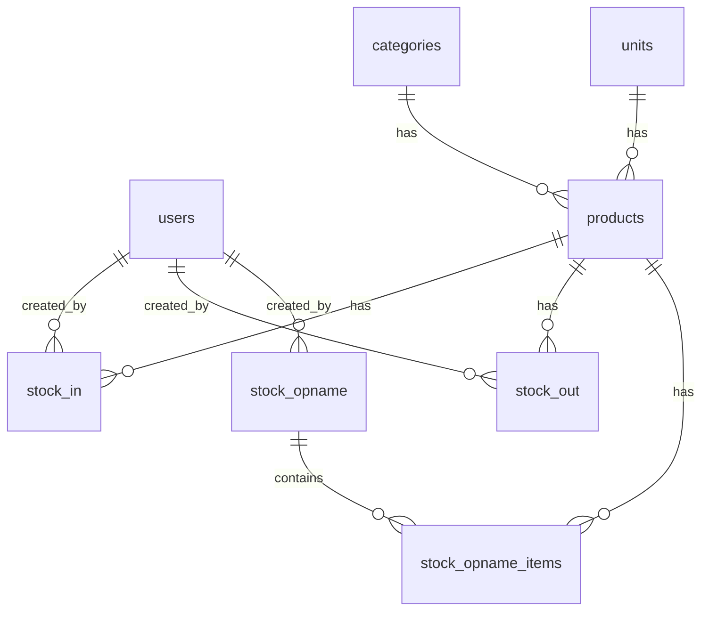
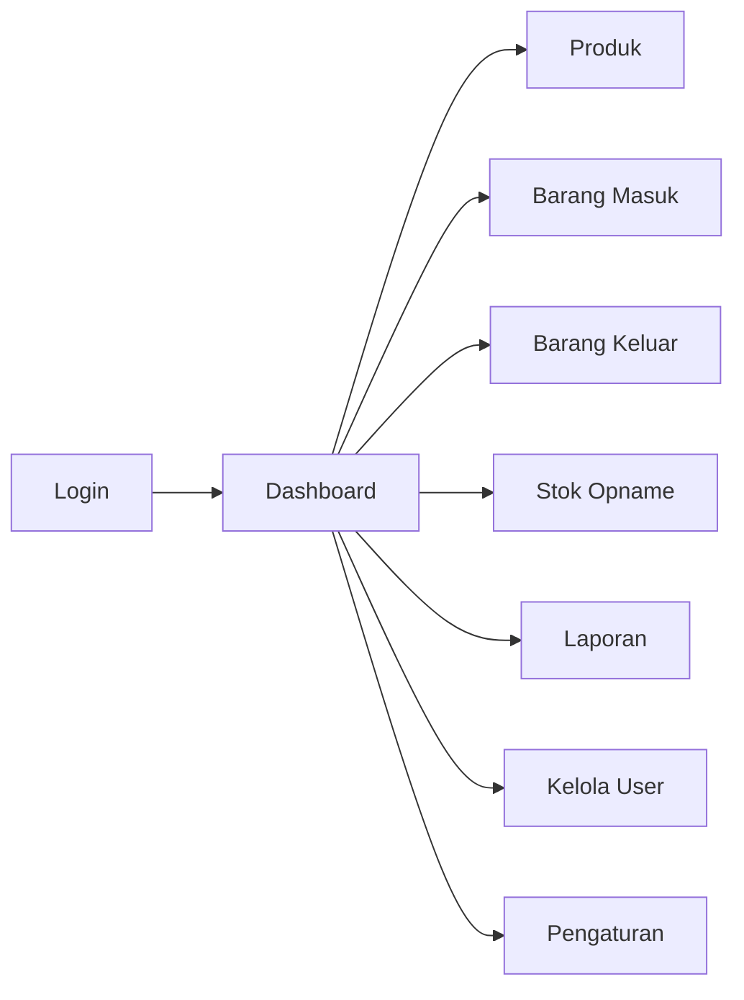

# 📦 PRD: Sistem Manajemen Inventori — PT Global Medika Indonesia

> **Versi**: 1.0  
> **Tanggal**: 9 November 2026  
> **Status**: Draft — Menunggu Persetujuan  

---

## 1. Ringkasan Eksekutif

Sistem Manajemen Inventori (selanjutnya disebut **"Inventori GMI"**) adalah aplikasi web internal untuk mengelola stok barang alat kesehatan milik PT Global Medika Indonesia. Sistem ini dirancang **sesederhana mungkin** untuk membantu Admin Gudang mencatat barang masuk/keluar, memonitor stok realtime, dan menghasilkan laporan yang dapat dijadikan acuan reporting ke manajemen perusahaan.

### Kenapa Dibutuhkan?
- Pencatatan stok masih dilakukan secara manual / spreadsheet
- Tidak ada satu sumber kebenaran (single source of truth) untuk jumlah stok
- Laporan untuk manajemen harus dikompilasi secara manual
- Risiko human error tinggi (stok salah hitung, barang expired tidak terpantau)

---

## 2. Tujuan & Sasaran

| # | Tujuan | Ukuran Keberhasilan |
|---|--------|-------------------|
| 1 | Admin Gudang bisa mencatat barang masuk & keluar dalam < 1 menit per transaksi | Waktu input terukur dari demo |
| 2 | Stok realtime bisa dilihat kapan saja | Dashboard selalu up-to-date |
| 3 | Laporan stok bisa di-export ke Excel/PDF | Tombol export berfungsi |
| 4 | Barang mendekati expired bisa dideteksi otomatis | Alert muncul di dashboard |
| 5 | Stok minimum bisa di-set per produk, alert jika di bawah threshold | Alert muncul di dashboard |

---

## 3. Pengguna Target

| Role | Deskripsi | Akses Utama |
|------|-----------|-------------|
| **Admin** | Administrator & pengelola sistem | Semua fitur, termasuk kelola user & pengaturan |
| **Admin Gudang** | Staff gudang operasional | Catat barang masuk/keluar, lihat stok, laporan |
| **Viewer** | Manajemen / pihak yang perlu melihat laporan | Dashboard & laporan (read-only) |

> [!NOTE]
> Hanya 3 role untuk menjaga kesederhanaan. Tidak ada approval chain yang kompleks.

---

## 4. Konteks Perusahaan

| Data | Nilai |
|------|-------|
| Nama Perusahaan | PT Global Medika Indonesia |
| Bidang Usaha | Distributor Alat Kesehatan (KBLI 46691) |
| NIB | 0220202600123 |
| IDAK | IDAK-2026-02-0089 |
| Alamat Gudang | Kawasan Industri & Pergudangan Medika Square Blok B No. 7, Jakarta Timur |
| Direktur | Farrel Nouvaleo Akbar |

---

## 5. Fitur & Scope

### 5.1 ✅ Dalam Scope (MVP)

#### A. Dashboard
- Ringkasan stok: total item, total unit, nilai stok (estimasi)
- Widget **Stok Rendah** (di bawah minimum threshold)
- Widget **Mendekati Expired** (≤ 90 hari)
- Widget **Aktivitas Terbaru** (5 transaksi terakhir)
- Grafik sederhana: pergerakan stok 30 hari terakhir (bar chart)

#### B. Master Produk
- CRUD produk dengan field:
  - Kode produk (auto-generate atau manual)
  - Nama produk
  - Kategori (dropdown: Radiologi, Elektromedik, IVD, Bedah, Rehabilitasi, Lab, Umum)
  - Satuan (pcs, box, unit, pack, dll)
  - Stok minimum (threshold untuk alert)
  - Harga satuan (opsional, untuk estimasi nilai stok)
  - Deskripsi / catatan
  - Foto produk (opsional)
- Pencarian & filter berdasarkan nama, kode, kategori
- Soft delete (produk yang sudah ada transaksinya tidak bisa di-hapus permanen)

#### C. Barang Masuk (Stock In)
- Form input:
  - Pilih produk (autocomplete search)
  - Jumlah masuk
  - Tanggal masuk
  - Nomor batch / lot (opsional)
  - Tanggal expired (opsional, untuk produk yang punya masa pakai)
  - Supplier / asal barang (free text)
  - Nomor referensi (PO, Surat Jalan, dll — free text)
  - Catatan
- Stok otomatis bertambah setelah simpan
- Riwayat barang masuk bisa dilihat dan di-filter

#### D. Barang Keluar (Stock Out)
- Form input:
  - Pilih produk (autocomplete search)
  - Jumlah keluar
  - Tanggal keluar
  - Tujuan / penerima (free text — nama RS, klinik, customer)
  - Nomor referensi (DO, Surat Jalan, dll — free text)
  - Catatan
- Validasi: jumlah keluar tidak boleh melebihi stok tersedia
- Stok otomatis berkurang setelah simpan
- Riwayat barang keluar bisa dilihat dan di-filter

#### E. Stok Opname (Stock Check)
- Halaman untuk membandingkan stok sistem vs stok fisik
- Input stok fisik per produk
- Hitung selisih otomatis
- Simpan hasil opname sebagai catatan adjustment
- Stok sistem di-update sesuai hasil opname (dengan catatan adjustment reason)

#### F. Laporan & Export
- **Laporan Stok Saat Ini**: Daftar semua produk + stok terkini + nilai
- **Laporan Pergerakan Stok**: Riwayat masuk/keluar per periode (filter tanggal)
- **Laporan Barang Mendekati Expired**: Produk yang expired dalam 30/60/90 hari
- **Laporan Stok Rendah**: Produk di bawah minimum threshold
- **Laporan Stok Opname**: Hasil stock opname terakhir + selisih
- Semua laporan bisa di-**export ke Excel (.xlsx)**
- Laporan Stok Saat Ini juga bisa di-**export ke PDF** (format siap cetak)

#### G. Manajemen User (Admin Only)
- CRUD user (nama, email, password, role)
- Aktifkan / nonaktifkan user
- Reset password

#### H. Pengaturan (Admin Only)
- Profil perusahaan (nama, alamat — ditampilkan di header laporan)
- Manajemen kategori produk
- Manajemen satuan produk

### 5.2 ❌ Di Luar Scope (Tidak Dibangun)
- Purchasing / PO management
- Sales order / invoicing
- Multi-gudang / multi-cabang
- Barcode / QR scanning
- Integrasi ke sistem eksternal (ERP, accounting)
- Approval chain (semua transaksi langsung tersimpan)
- CDAKB compliance tracking
- Recall / complaint management
- Notifikasi email / WhatsApp

---

## 6. Tech Stack

| Komponen | Pilihan | Alasan |
|----------|---------|--------|
| Framework | **Next.js 16** (App Router) | Sama dengan project sebelumnya, familiar |
| Bahasa | **TypeScript** | Type safety |
| Styling | **Tailwind CSS v4 + shadcn/ui** | Rapid UI development, konsisten |
| Database | **SQLite** (via better-sqlite3 + Drizzle ORM) | **Zero config**, tidak perlu install PostgreSQL, cukup untuk skala ini |
| Auth | **JWT HttpOnly cookie** (jose + bcryptjs) | Simpel, sudah proven dari project sebelumnya |
| Export Excel | **xlsx** (SheetJS) | Library export Excel paling populer |
| Export PDF | **jsPDF + jsPDF-autotable** | Generate PDF dari data table |
| Chart | **Recharts** | Charting library populer untuk React |

> [!IMPORTANT]
> Database menggunakan **SQLite** (file-based) — tidak perlu install atau setup database server apapun. File database akan tersimpan di folder project (`data/inventory.db`).

---

## 7. Arsitektur & Data Model

### 7.1 Diagram Relasi



### 7.2 Tabel Database

#### `users`
| Kolom | Tipe | Keterangan |
|-------|------|------------|
| id | TEXT (UUID) | Primary key |
| name | TEXT | Nama lengkap |
| email | TEXT | Unique, untuk login |
| password_hash | TEXT | Hash bcrypt |
| role | TEXT | `admin`, `gudang`, `viewer` |
| is_active | INTEGER | 1 = aktif, 0 = nonaktif |
| created_at | TEXT | ISO timestamp |
| updated_at | TEXT | ISO timestamp |

#### `categories`
| Kolom | Tipe | Keterangan |
|-------|------|------------|
| id | TEXT (UUID) | Primary key |
| name | TEXT | Nama kategori |
| created_at | TEXT | ISO timestamp |

#### `units`
| Kolom | Tipe | Keterangan |
|-------|------|------------|
| id | TEXT (UUID) | Primary key |
| name | TEXT | Nama satuan (pcs, box, unit) |
| created_at | TEXT | ISO timestamp |

#### `products`
| Kolom | Tipe | Keterangan |
|-------|------|------------|
| id | TEXT (UUID) | Primary key |
| code | TEXT | Kode produk (unique) |
| name | TEXT | Nama produk |
| category_id | TEXT (FK) | Referensi ke categories |
| unit_id | TEXT (FK) | Referensi ke units |
| min_stock | INTEGER | Minimum stok (default 0) |
| price | REAL | Harga satuan (opsional) |
| description | TEXT | Deskripsi |
| image_url | TEXT | Path foto produk |
| current_stock | INTEGER | Stok terkini (denormalized, dihitung ulang dari transaksi) |
| is_deleted | INTEGER | Soft delete flag |
| created_at | TEXT | ISO timestamp |
| updated_at | TEXT | ISO timestamp |

#### `stock_in` (Barang Masuk)
| Kolom | Tipe | Keterangan |
|-------|------|------------|
| id | TEXT (UUID) | Primary key |
| product_id | TEXT (FK) | Referensi ke products |
| quantity | INTEGER | Jumlah masuk |
| date | TEXT | Tanggal masuk |
| batch_number | TEXT | Nomor batch/lot (opsional) |
| expired_at | TEXT | Tanggal expired (opsional) |
| supplier | TEXT | Nama supplier / asal |
| reference_number | TEXT | Nomor PO/Surat Jalan |
| notes | TEXT | Catatan |
| created_by | TEXT (FK) | User yang input |
| created_at | TEXT | ISO timestamp |

#### `stock_out` (Barang Keluar)
| Kolom | Tipe | Keterangan |
|-------|------|------------|
| id | TEXT (UUID) | Primary key |
| product_id | TEXT (FK) | Referensi ke products |
| quantity | INTEGER | Jumlah keluar |
| date | TEXT | Tanggal keluar |
| destination | TEXT | Tujuan / penerima |
| reference_number | TEXT | Nomor DO/Surat Jalan |
| notes | TEXT | Catatan |
| created_by | TEXT (FK) | User yang input |
| created_at | TEXT | ISO timestamp |

#### `stock_opname` (Header Opname)
| Kolom | Tipe | Keterangan |
|-------|------|------------|
| id | TEXT (UUID) | Primary key |
| date | TEXT | Tanggal opname |
| notes | TEXT | Catatan umum |
| status | TEXT | `draft`, `final` |
| created_by | TEXT (FK) | User yang input |
| created_at | TEXT | ISO timestamp |

#### `stock_opname_items` (Detail Opname per Produk)
| Kolom | Tipe | Keterangan |
|-------|------|------------|
| id | TEXT (UUID) | Primary key |
| opname_id | TEXT (FK) | Referensi ke stock_opname |
| product_id | TEXT (FK) | Referensi ke products |
| system_stock | INTEGER | Stok menurut sistem |
| physical_stock | INTEGER | Stok fisik (input user) |
| difference | INTEGER | Selisih (physical - system) |
| reason | TEXT | Alasan selisih |

#### `company_settings`
| Kolom | Tipe | Keterangan |
|-------|------|------------|
| id | TEXT (UUID) | Primary key |
| company_name | TEXT | Nama perusahaan |
| address | TEXT | Alamat |
| phone | TEXT | Telepon |
| logo_url | TEXT | Path logo |
| updated_at | TEXT | ISO timestamp |

---

## 8. Halaman & Navigasi



### Daftar Halaman

| # | Halaman | Path | Akses |
|---|---------|------|-------|
| 1 | Login | `/login` | Public |
| 2 | Dashboard | `/` | Semua role |
| 3 | Daftar Produk | `/products` | Semua role |
| 4 | Tambah/Edit Produk | `/products/new`, `/products/[id]/edit` | Admin, Gudang |
| 5 | Daftar Barang Masuk | `/stock-in` | Semua role |
| 6 | Form Barang Masuk | `/stock-in/new` | Admin, Gudang |
| 7 | Daftar Barang Keluar | `/stock-out` | Semua role |
| 8 | Form Barang Keluar | `/stock-out/new` | Admin, Gudang |
| 9 | Stok Opname | `/opname` | Admin, Gudang |
| 10 | Form Stok Opname | `/opname/new` | Admin, Gudang |
| 11 | Laporan | `/reports` | Semua role |
| 12 | Kelola User | `/users` | Admin |
| 13 | Pengaturan | `/settings` | Admin |

**Total: 13 halaman** (jauh lebih sederhana dari project sebelumnya yang 26+ halaman)

---

## 9. Wireframe Konseptual

### Dashboard Layout

```
┌──────────────────────────────────────────────────────┐
│  🏢 Inventori GMI           [User ▾] [Logout]       │
├──────────┬───────────────────────────────────────────┤
│          │                                           │
│ Dashboard│  ┌─────────┐ ┌─────────┐ ┌─────────┐     │
│ Produk   │  │ Total   │ │ Total   │ │ Estimasi│     │
│ Brg Masuk│  │ Item    │ │ Unit    │ │ Nilai   │     │
│ Brg Kluar│  │   47    │ │  1,240  │ │ 850 jt  │     │
│ Opname   │  └─────────┘ └─────────┘ └─────────┘     │
│ Laporan  │                                           │
│ ──────── │  ┌─────────────────┐ ┌─────────────────┐  │
│ User     │  │ ⚠ Stok Rendah   │ │ ⏰ Exp ≤ 90 hari│  │
│ Setting  │  │ • Stetoskop (3) │ │ • Infus Set     │  │
│          │  │ • Masker N95(5) │ │   exp: 12/2026  │  │
│          │  │ • Sarung T. (2) │ │ • Masker N95    │  │
│          │  └─────────────────┘ │   exp: 01/2027  │  │
│          │                      └─────────────────┘  │
│          │  ┌────────────────────────────────────┐    │
│          │  │ 📊 Pergerakan Stok (30 hari)       │    │
│          │  │  ▓▓░░▓▓▓░▓▓▓░░▓▓░▓ (bar chart)    │    │
│          │  └────────────────────────────────────┘    │
│          │                                           │
│          │  ┌────────────────────────────────────┐    │
│          │  │ 🕐 Aktivitas Terbaru               │    │
│          │  │  IN  | Stetoskop x10 | 09 Nov 2026 │    │
│          │  │  OUT | Masker x50    | 08 Nov 2026 │    │
│          │  │  IN  | Infus Set x20 | 07 Nov 2026 │    │
│          │  └────────────────────────────────────┘    │
└──────────┴───────────────────────────────────────────┘
```

---

## 10. Milestone & Timeline

### Milestone 0 — Foundation (Sprint 0)
**Estimasi: 1 sesi kerja**

- Setup Next.js 16 + TypeScript + Tailwind v4 + shadcn/ui
- Setup SQLite + Drizzle ORM schema + migration
- Seed data awal (admin user, kategori, satuan, contoh produk)
- Layout utama (sidebar, header, responsive)
- Halaman login + auth (JWT)
- Setup project structure

### Milestone 1 — Master Data & Stok
**Estimasi: 1-2 sesi kerja**

- CRUD Produk (termasuk search, filter, soft delete)
- CRUD Kategori & Satuan (di halaman Pengaturan)
- Barang Masuk (form + daftar riwayat)
- Barang Keluar (form + daftar riwayat + validasi stok)
- Update stok otomatis (current_stock di tabel products)

### Milestone 2 — Dashboard, Opname & Laporan
**Estimasi: 1-2 sesi kerja**

- Dashboard dengan widget stok rendah, expired, aktivitas terbaru
- Chart pergerakan stok 30 hari (Recharts)
- Stok Opname (form + adjustment)
- Semua laporan (5 jenis)
- Export Excel (.xlsx)
- Export PDF (laporan stok saat ini)

### Milestone 3 — Polish & User Management
**Estimasi: 1 sesi kerja**

- Kelola User (CRUD + aktivasi/nonaktifkan)
- Pengaturan profil perusahaan (header laporan)
- Responsive design polish
- Empty states, loading states, error handling
- Final testing & QA

**Total estimasi: 4-6 sesi kerja**

---

## 11. Seed Data Awal

Sistem akan di-seed dengan data berikut agar langsung bisa dipakai/demo:

### Users
| Email | Role | Password |
|-------|------|----------|
| admin@globalmedika.co.id | Admin | `Inventori2026!` |
| gudang@globalmedika.co.id | Admin Gudang | `Inventori2026!` |
| viewer@globalmedika.co.id | Viewer | `Inventori2026!` |

### Kategori
Radiologi, Elektromedik, IVD, Bedah & Ortopedi, Rehabilitasi, Laboratorium, Umum

### Satuan
pcs, box, unit, pack, set, roll, botol

### Contoh Produk (10 item)
| Kode | Nama | Kategori | Satuan | Min Stok | Stok Awal |
|------|------|----------|--------|----------|-----------|
| PRD-001 | Stetoskop Digital SD-700 | Elektromedik | pcs | 10 | 25 |
| PRD-002 | Pulse Oximeter PO-300 | Elektromedik | pcs | 15 | 40 |
| PRD-003 | Infus Set Macro 20tpm | Umum | box | 50 | 120 |
| PRD-004 | Masker N95 3M 9501+ | Umum | box | 30 | 85 |
| PRD-005 | Sarung Tangan Nitrile M | Umum | box | 100 | 200 |
| PRD-006 | Rapid Test Kit Antigen | IVD | box | 20 | 60 |
| PRD-007 | Film X-Ray 35x43cm | Radiologi | box | 10 | 30 |
| PRD-008 | Thermometer Digital DT-01 | Elektromedik | pcs | 20 | 50 |
| PRD-009 | Nebulizer Compressor NB-10 | Rehabilitasi | unit | 5 | 12 |
| PRD-010 | Surgical Blade No. 15 | Bedah & Ortopedi | box | 25 | 70 |

### Contoh Transaksi (untuk demo dashboard)
- 10 transaksi barang masuk (varied dates, last 30 days)
- 8 transaksi barang keluar (varied dates, last 30 days)

---

## 12. Non-Functional Requirements

| Aspek | Requirement |
|-------|------------|
| **Performance** | Halaman load < 2 detik (SQLite sangat cepat untuk skala ini) |
| **Data Safety** | Soft delete untuk produk yang punya transaksi; transaksi stok tidak bisa dihapus (immutable) |
| **Responsive** | Mobile-friendly, bisa diakses via tablet di gudang |
| **Browser** | Chrome, Edge, Firefox (modern browsers) |
| **Bahasa UI** | Bahasa Indonesia |
| **Kapasitas** | Mendukung hingga ~10,000 produk dan ~100,000 transaksi (lebih dari cukup untuk skala ini) |
| **Backup** | File SQLite bisa di-copy/backup secara manual |

---

## 13. Keamanan

- Login wajib untuk semua halaman (kecuali `/login`)
- Password di-hash dengan bcrypt (cost factor 10)
- Session via JWT HttpOnly cookie (expire 8 jam)
- Role-based access: Viewer tidak bisa create/edit/delete
- Brute-force protection: 5x gagal login → akun terkunci 15 menit
- CSRF protection via Server Actions (bawaan Next.js)

---

## 14. Keputusan Desain Penting

> [!TIP]
> **Kenapa SQLite, bukan PostgreSQL?**
> - Zero configuration — tidak perlu install database server
> - File database portable — bisa di-backup dengan copy file
> - Sangat cepat untuk read-heavy workload seperti inventory
> - Lebih dari cukup untuk skala perusahaan ini (< 100 user concurrent)

> [!TIP]
> **Kenapa `current_stock` di-denormalize di tabel products?**
> - Performa: tidak perlu SUM() transaksi setiap kali tampilkan stok
> - Di-update secara atomic setiap ada stock_in / stock_out / opname
> - Bisa di-recalculate dari riwayat transaksi jika perlu (data integrity check)

> [!NOTE]
> **Field opsional untuk batch & expired**
> - Tidak semua produk alat kesehatan punya expired date (contoh: stetoskop)
> - Batch number juga opsional karena bisa jadi tidak relevan untuk semua produk
> - Tapi field-nya disediakan agar yang punya expiry bisa dilacak dan muncul di alert

---

## 15. Risiko & Mitigasi

| Risiko | Dampak | Mitigasi |
|--------|--------|---------|
| Data hilang (file SQLite corrupt/terhapus) | Tinggi | Dokumentasikan cara backup manual; pertimbangkan auto-backup script |
| User lupa password | Rendah | Admin bisa reset password |
| Concurrent write conflict (SQLite) | Rendah | WAL mode aktif; skala user kecil sehingga contention minimal |
| Stok tidak akurat | Sedang | Fitur Stok Opname untuk rekonsiliasi berkala |

---

## 16. Perbandingan dengan Project Sebelumnya (SIM Alkes GMI)

| Aspek | SIM Alkes GMI (Lama) | Inventori GMI (Baru) |
|-------|---------------------|---------------------|
| Tabel Database | 33 tabel | **8 tabel** |
| Halaman | 26+ halaman | **13 halaman** |
| Role | 6 role + RBAC matrix | **3 role** |
| Database | PostgreSQL (perlu install) | **SQLite (zero config)** |
| Fitur | PO, GR, PJT, SPH, SO, DO, Invoice, Payment, CDAKB | **Stok masuk/keluar, opname, laporan** |
| Kompleksitas | Sangat tinggi | **Rendah** |

---

## Checklist Persetujuan

Sebelum mulai development, konfirmasi item berikut:

- [ ] Scope fitur sudah sesuai kebutuhan?
- [ ] Data model (tabel) sudah cukup?
- [ ] Tech stack (Next.js + SQLite) disetujui?
- [ ] Apakah project ini menggantikan SIM Alkes GMI di folder yang sama, atau dibuat di folder baru?
- [ ] Ada fitur tambahan yang perlu ditambahkan?
- [ ] Ada fitur yang harus di-remove?

---

> **Catatan**: PRD ini sengaja dirancang **minimalis dan praktis**. Fokusnya adalah sistem yang langsung bisa dipakai oleh Admin Gudang tanpa perlu training yang rumit. Fitur-fitur yang tidak essential bisa ditambahkan di iterasi berikutnya jika dibutuhkan.
